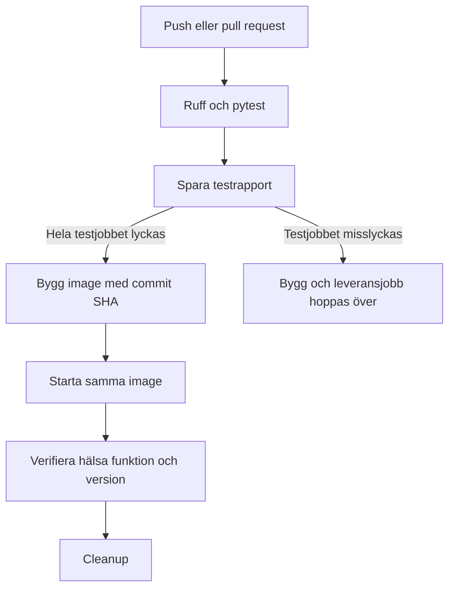

# CI/CD med FastAPI och Docker

Mitt examinationsprojekt i DEVOPS25. Jag har vidareutvecklat kursens FastAPI-mall och byggt en sammanhängande kedja som testar koden, bygger en Docker-image och verifierar applikationen i en tillfällig testmiljö.

Projektarbetet finns på branchen **`projekt/examination`**.

- [Skriftlig redogörelse](docs/examinationsrapport.md)
- [Stöd för den muntliga redovisningen](docs/redovisningsstod.md)
- [Aktivt workflow](.github/workflows/ci.yml)

## Syfte och egna ändringar

Jag vill få snabb återkoppling och kunna följa en ändring från commit till körande app. Varje kontroll ska ge ett underlag för att gå vidare eller stoppa flödet.

Jag utgår från [kursmallen](https://github.com/cloudfactoreu/devops25-ci-cd-course). Den innehöll appens beräkningsfunktioner, fem tester, Dockerfile och grundläggande workflows. Jag har lagt till:

- Versionsadressen `/version` och ett API-test för versionssvaret.
- Kontrollerad hantering av division med noll i API:et och ett API-test för HTTP 400 och feltext.
- CI-start vid push till projektbranchen.
- JUnit-rapport som sparas som en artifact i Actions.
- Containerstart, kontroll av hälsa, addition och version samt städning i samma jobb som bygget.
- Kontrollerad felövning och dokumentation av manuell lokal rollback.

Jag har tagit bort den fristående CD-mallen från projektbranchen. Den aktiva kedjan finns samlad i `ci.yml` och har ett beroende av godkända kontroller.

## Kedjans flöde



Diagrammet visar huvudflödet. Rapportsteget har `if: always()` och försöker spara en producerad rapport även efter testfel. `build-image` har `needs: test`, så hela testjobbet måste lyckas. Cleanup har också `if: always()` och försöker städa även om verifieringen blir röd.

Workflowet startar vid push till `main` eller `projekt/examination`, PR mot `main` och manuell start i Actions. De verifierade projektkörningarna nedan startade genom push.

## App och tester

| Adress | Beteende |
| --- | --- |
| `/health` | Svarar med `{"status":"ok"}` |
| `/api/add?a=100&b=5` | Svarar med `{"result":105}` |
| `/api/divide?a=10&b=0` | HTTP 400 och `{"detail":"Cannot divide by zero"}` i version 1.0.1 |
| `/version` | Svarar med `{"version":"1.0.1"}` |

Testsviten innehåller sju tester: tre service-tester och fyra API-tester. Service-testerna provar funktionerna direkt. API-testerna går genom FastAPI med TestClient. Efter containerstart verifierar workflowet dessutom den faktiskt körande appens hälsa, addition och version.

Testjobbet använder Python 3.12 och installerar beroenden från `requirements.txt`. Ruff kör `ruff check app tests`. Pytest kör `pytest --junitxml=reports/pytest.xml`, och rapporten sparas i Actions som **`pytest-results`**.

## Verifierade körningar

| Händelse | Commit | Körning |
| --- | --- | --- |
| Första leveransförsöket stoppades vid hälsokontrollen | `2924302` | [Röd körning](https://github.com/issamhariri-code/devops25-ci-cd-course/actions/runs/43895495089) |
| Utökad väntan och hämtning före JSON-tolkning | `bc44598` | [Grön kedja](https://github.com/issamhariri-code/devops25-ci-cd-course/actions/runs/43897535571) |
| Kontrollen förväntade 9.9.9 medan appen körde 1.0.1 | `721d6eb` | [Avsiktligt röd verifiering](https://github.com/issamhariri-code/devops25-ci-cd-course/actions/runs/44057277021) |
| Förväntad version återställd till 1.0.1 | `53634bb` | [Grön kedja igen](https://github.com/issamhariri-code/devops25-ci-cd-course/actions/runs/44058055772) |
| Fristående CD-mall borttagen från projektbranchen | `1d2a24e` | [Grön projektkedja](https://github.com/issamhariri-code/devops25-ci-cd-course/actions/runs/44071844040) |

I versionsövningen lyckades tester, bygge, start, hälsa och addition. Versionsjämförelsen gav sedan fel och stoppade jobbet. Cleanup lyckades även då. Det visar varför rätt versionssvar behöver verifieras efter starten.

## Lokal körning

Python-testerna kräver projektets beroenden i vald Pythonmiljö:

```bash
python -m pytest
python -m ruff check app tests
```

För containerkörning behöver Docker vara igång och port 8000 vara ledig. Bygg från projektets rotmapp:

```bash
docker build -t cicd-examination:1.0.1 .
docker run --rm --name cicd-examination -p 127.0.0.1:8000:8000 cicd-examination:1.0.1
```

Öppna därefter [versionsadressen](http://127.0.0.1:8000/version) eller [API-dokumentationen](http://127.0.0.1:8000/docs).

## Versioner och manuell rollback

Jag har byggt två lokala appversioner och kontrollerat att de har olika image-id:

| Appversion | Kodcommit för versionen | Lokalt image-id |
| --- | --- | --- |
| 1.0.0 | `c4541fd` | `0f452bcaccf4` |
| 1.0.1 | `166d395` | `f08bd6f11c71` |

Jag genomförde rollback genom att stoppa och ta bort containern för 1.0.1 och starta en ny från den sparade imagen 1.0.0. Jag verifierade version 1.0.0, HTTP 200 och resultat 105 för addition samt att containerns image-id matchade den äldre imagen. Källkoden i projektmappen var fortfarande 1.0.1. Efter övningen återgick jag till den sparade imagen 1.0.1 och kontrollerade versionen igen.

De äldre lokala images som jag använt följer inte med en vanlig Git-kloning. De har inte publicerats i ett registry. Image-id ovan beskriver mina genomförda lokala byggen; ett senare ombygge kan få ett annat id.

## Begränsningar och fortsatt utveckling

Leveransen i Actions är simulerad. Containern körs tillfälligt på runnern och tas bort efter verifieringen. CI-imagen publiceras inte i ett registry. Versionsnumret i appen och det förväntade värdet i workflowet uppdateras manuellt.

Rollbackövningen var manuell, gav ett avbrott och återställde ingen beständig data. Den äldre versionen saknar den nya felhanteringen för division med noll. Det ursprungliga `scripts/rollback_local.sh` är en platshållare från kursmallen och utförde inte min rollback. De ursprungliga skripten ligger kvar som kursreferenser; den aktiva automatiska verifieringen finns i workflowet.

För produktion skulle jag prioritera beständigt lagrade images med tydlig identitet, fler testfall, säkerhetskontroller, hantering av behörigheter och miljöer samt övervakning och en plan för data vid återställning. Motiveringar, resultat och reflektion finns i rapporten.
